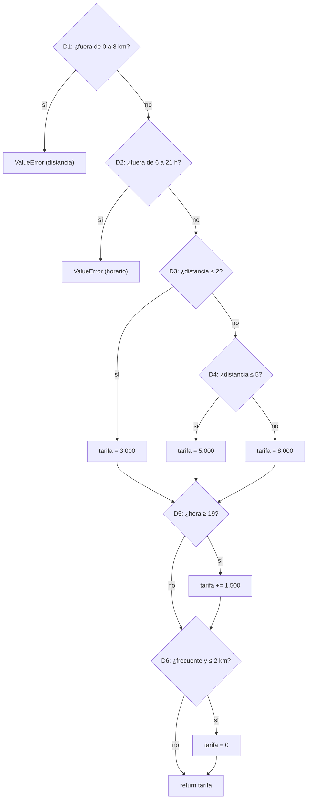

# Caso de estudio · Tipos de pruebas y herramientas — Entregables del equipo

> Patrones y Metodologías para la Construcción de Software · Sesión 13
> Pregunta central: *Si un conjunto de pruebas recorre el 100 % de las ramas del código, ¿podemos confiar en que la función está libre de defectos?*
> **Respuesta corta: no.** Los tres conjuntos de este proyecto llegan a 12 de 12 ramas, y solo el de valores límite encuentra los defectos sembrados (ver [Paso 3.3](#paso-33--la-prueba-de-fuego)).

| Entregable de la guía | Dónde está |
|---|---|
| 1. Tabla de clases de equivalencia y casos EP | [Paso 1](#paso-1--partición-de-equivalencia) · [`test_equivalencia.py`](../test_equivalencia.py) |
| 2. Tabla de valores límite | [Paso 2](#paso-2--valores-límite) · [`test_valores_limite.py`](../test_valores_limite.py) |
| 3. Grafo de flujo, V(G), casos de ramas y reporte de coverage | [Paso 3.1 y 3.2](#paso-31--grafo-de-flujo-y-complejidad) · [`test_ramas.py`](../test_ramas.py) |
| 4. Registro de la prueba de fuego con sus respuestas | [Paso 3.3](#paso-33--la-prueba-de-fuego) · [`scripts/prueba_de_fuego.py`](../scripts/prueba_de_fuego.py) |
| 5. Matriz de herramientas justificada | [Paso 4](#paso-4--selección-de-herramientas) |

Código bajo prueba: [`domicilio.py`](../domicilio.py) (`tarifa_domicilio`, copiado tal como lo entrega la guía).

Cómo reproducir la evidencia:

```bash
python -m pip install -r requirements.txt                       # flask, pytest y coverage
python -m pytest -q test_equivalencia.py                        # 8 casos
python -m pytest -q test_valores_limite.py                      # 16 casos
python -m coverage run --branch -m pytest -q test_ramas.py      # 5 casos
python -m coverage report -m                                    # domicilio.py → 100 %
python scripts/prueba_de_fuego.py                               # registro de la prueba de fuego
python scripts/prueba_de_fuego.py --mutantes                    # qué conjunto detecta cada cambio de comparación
```

---

## Paso 1 · Partición de equivalencia

Solo con la especificación (E1 a E5), sin mirar el código.

### Clases

| ID | Variable | Clase (rango o condición) | Tipo | Representante |
|---|---|---|---|---|
| C1 | `distancia_km` | d ≤ 0 | Inválida | −2,5 |
| C2 | `distancia_km` | 0 < d ≤ 2 | Válida | 1,0 |
| C3 | `distancia_km` | 2 < d ≤ 5 | Válida | 3,5 |
| C4 | `distancia_km` | 5 < d ≤ 8 | Válida | 6,5 |
| C5 | `distancia_km` | d > 8 | Inválida | 12,0 |
| C6 | `hora` | h < 6 | Inválida | 3 |
| C7 | `hora` | 6 ≤ h ≤ 18 (sin recargo) | Válida | 12 |
| C8 | `hora` | 19 ≤ h ≤ 21 (con recargo) | Válida | 20 |
| C9 | `hora` | h > 21 | Inválida | 23 |
| C10 | `cliente_frecuente` | Es frecuente | Válida | `True` |
| C11 | `cliente_frecuente` | No es frecuente | Válida | `False` |

### Casos de prueba

| Caso | Distancia | Hora | Frecuente | Clases que cubre | Resultado esperado |
|---|---|---|---|---|---|
| EP-1 | 1,0 | 12 | No | C2, C7, C11 | 3.000 |
| EP-2 | 3,5 | 20 | No | C3, C8, C11 | 6.500 (5.000 + 1.500) |
| EP-3 | 6,5 | 10 | Sí | C4, C7, C10 | 8.000 (frecuente, pero a más de 2 km) |
| EP-4 | 1,0 | 15 | Sí | C2, C7, C10 | 0 (regla E5) |
| EP-5 | −2,5 | 12 | No | C1 | `ValueError` |
| EP-6 | 12,0 | 12 | No | C5 | `ValueError` |
| EP-7 | 3,5 | 3 | No | C6 | `ValueError` |
| EP-8 | 3,5 | 23 | No | C9 | `ValueError` |

Reglas de combinación aplicadas: un caso válido cubre varias clases a la vez (EP-1 a EP-4) y cada caso inválido cubre
**una sola** clase inválida, con el resto de valores válidos (EP-5 a EP-8). Todas las clases (C1 a C11) quedan cubiertas.

**Preguntas del paso**

1. *¿Cuántas clases y cuántos casos?* Distancia: **5** clases (3 válidas, 2 inválidas). Hora: **4** clases (2 válidas, 2 inválidas).
   Cliente frecuente: **2** clases. Son **11** clases en total y se necesitaron **8** casos (4 válidos y 4 inválidos).
2. *¿Por qué E5 obliga a pensar en una combinación?* Porque la regla depende de dos variables a la vez: "frecuente **y** a 2 km o
   menos". Si cada variable se cubriera por separado, `True` podría probarse solo a 6,5 km (EP-3), donde sí se paga domicilio, y
   nunca se ejecutaría la combinación que activa la excepción. Por eso existe EP-4, que reúne C2 y C10.

---

## Paso 2 · Valores límite

Fronteras de la distancia: 0, 2, 5 y 8 (2, 5 y 8 pertenecen al tramo de su izquierda; 0 queda fuera de cobertura).
Valores neutros: hora 10 y no frecuente al probar la distancia; 1 km y no frecuente al probar la hora.

| Caso | Variable | Frontera | Valor probado | Resultado esperado |
|---|---|---|---|---|
| VL-1 | `distancia_km` | 0 | 0 | `ValueError` |
| VL-2 | `distancia_km` | 0 | 0,1 | 3.000 |
| VL-3 | `distancia_km` | 2 | 2 | 3.000 |
| VL-4 | `distancia_km` | 2 | 2,1 | 5.000 |
| VL-5 | `distancia_km` | 5 | 5 | 5.000 |
| VL-6 | `distancia_km` | 5 | 5,1 | 8.000 |
| VL-7 | `distancia_km` | 8 | 8 | 8.000 |
| VL-8 | `distancia_km` | 8 | 8,1 | `ValueError` |
| VL-9 | `hora` | 6 | 5 | `ValueError` |
| VL-10 | `hora` | 6 | 6 | 3.000 |
| VL-11 | `hora` | 19 | 18 | 3.000 |
| VL-12 | `hora` | 19 | 19 | 4.500 (3.000 + 1.500) |
| VL-13 | `hora` | 21 | 21 | 4.500 |
| VL-14 | `hora` | 21 | 22 | `ValueError` |
| VL-15 | `distancia_km` (frecuente, hora 10) | 2 (E5) | 2 | 0 |
| VL-16 | `distancia_km` (frecuente, hora 10) | 2 (E5) | 2,1 | 5.000 |

**Preguntas del paso**

1. *¿Cuántos casos y cuántos ya estaban en la partición?* **16** casos de valores límite. **Ninguno** estaba en la partición de
   equivalencia, porque sus representantes se eligieron en el centro de cada clase (1,0 · 3,5 · 6,5 · 12 · 20…), lejos de las fronteras.
2. *Si se permitieran dos decimales, ¿qué valor junto a la frontera de 2 km?* **2,01** (un paso de 0,01 km), junto con el valor
   exacto 2,00. Con 2,1 quedaría sin probar el intervalo (2,00 ; 2,10), donde también podría esconderse un defecto.

---

## Paso 3 · Caja blanca y cobertura de ramas

### Paso 3.1 · Grafo de flujo y complejidad



- **Decisiones:** 6 (D1 a D6; cada `if` o `elif` cuenta una, aunque la condición use `or` o `and`).
- **Ramas:** 6 × 2 = **12**.
- **Complejidad ciclomática:** V(G) = decisiones + 1 = 6 + 1 = **7**, es decir, 7 caminos independientes.

### Paso 3.2 · Conjunto mínimo de casos para el 100 % de ramas

| Rama | Descripción | La recorre |
|---|---|---|
| D1-sí | distancia ≤ 0 o > 8 → `ValueError` | caso R-1 |
| D1-no | distancia en (0 ; 8] | R-2 a R-5 |
| D2-sí | hora < 6 o > 21 → `ValueError` | R-2 |
| D2-no | hora en [6 ; 21] | R-3 a R-5 |
| D3-sí | distancia ≤ 2 | R-3 |
| D3-no | distancia > 2 | R-4, R-5 |
| D4-sí | distancia ≤ 5 | R-4 |
| D4-no | distancia > 5 | R-5 |
| D5-sí | hora ≥ 19 | R-3 |
| D5-no | hora < 19 | R-4, R-5 |
| D6-sí | frecuente y ≤ 2 km | R-3 |
| D6-no | no cumple | R-4, R-5 |

| Caso | Distancia | Hora | Frecuente | Ramas nuevas | Resultado |
|---|---|---|---|---|---|
| R-1 | −1 | 10 | No | D1-sí | `ValueError` |
| R-2 | 1 | 3 | No | D1-no, D2-sí | `ValueError` |
| R-3 | 1 | 20 | Sí | D2-no, D3-sí, D5-sí, D6-sí | 0 |
| R-4 | 3 | 10 | No | D3-no, D4-sí, D5-no, D6-no | 5.000 |
| R-5 | 6 | 10 | No | D4-no | 8.000 |

**Son 5 casos y no se puede con menos:** D1-sí y D2-sí terminan la función con una excepción, así que cada una necesita su caso;
y entre D4-sí, D4-no y la ruta corta (D3-sí) hay tres caminos hasta el `return` que no se pueden combinar en uno solo.

Reporte de `coverage` con `test_ramas.py` (`python -m coverage run --branch -m pytest -q test_ramas.py` y `python -m coverage report -m`):

```
Name           Stmts   Miss Branch BrPart  Cover   Missing
----------------------------------------------------------
domicilio.py      15      0     12      0   100%
----------------------------------------------------------
```

Con solo los dos casos de ejemplo de la guía (1 km a las 20 h frecuente, y 3 km a las 10 h) se obtiene **78 %**, 3 sentencias sin
ejecutar y 3 decisiones con una rama pendiente. Las líneas que aparecen en `Missing` (21, 23, 29) difieren de las de la guía
(3, 5, 11) porque `domicilio.py` de este proyecto lleva la especificación como docstring al inicio; son las mismas sentencias:
los dos `raise` y `tarifa = 8_000`.

### Paso 3.3 · La prueba de fuego

El docente entrega `domicilio_equipo.py`. Para repetir el registro con ese archivo basta una de estas dos opciones:

```bash
python scripts/prueba_de_fuego.py ruta/al/domicilio_equipo.py     # no toca domicilio.py
# o copiarlo a la raíz del proyecto y ejecutar sin argumentos:
python scripts/prueba_de_fuego.py
```

> **Importante:** el archivo del docente no vino con el proyecto, así que la tabla de abajo se midió con
> [`scripts/domicilio_equipo_ejemplo.py`](../scripts/domicilio_equipo_ejemplo.py), una versión de ejemplo con dos defectos en
> comparaciones de frontera (`<= 5` → `< 5` y `>= 19` → `> 19`). Si los defectos del archivo real son otros, hay que volver a
> ejecutar el script y actualizar esta tabla y las respuestas.

| Conjunto de pruebas | Casos | Cobertura de ramas | Fallas con `domicilio_equipo` |
|---|---|---|---|
| Partición de equivalencia | 8 | 12/12 (100 %) | 0 |
| Valores límite | 16 | 12/12 (100 %) | **2** (VL-5 y VL-12) |
| Ramas (Paso 3.2) | 5 | 12/12 (100 %) | 0 |

**Preguntas del paso**

1. *¿Qué conjuntos alcanzan el 100 % de ramas? ¿Cuáles detectan los defectos?* **Los tres** alcanzan 12/12. **Solo valores
   límite** detecta los defectos: VL-5 (5 km cobra 8.000 en lugar de 5.000) y VL-12 (a las 19 h no hay recargo).
2. *¿Por qué la cobertura de ramas no los notó?* Los defectos cambian el operador de una comparación (`<=` por `<`, `>=` por `>`),
   no la estructura del código. La cobertura de ramas solo comprueba que cada `if` se haya evaluado como verdadero y como falso al
   menos una vez; con 3 km y 6 km la decisión D4 da sí y no igual en las dos versiones, y con 10 h y 20 h pasa lo mismo con D5.
   Nadie preguntó qué pasa **justo en** 5 km o 19 h. Cobertura mide qué se ejecutó, no si el resultado fue el correcto en la frontera.
3. *Pregunta central con datos propios.* **No.** Los 5 casos de ramas llegan al 100 % y la versión defectuosa los pasa todos.
   El 100 % de ramas dice que no hay código sin ejecutar, no que el código sea correcto. Hacen falta ambas cajas: la negra
   (valores límite) halló lo que la blanca no podía ver.

Complemento: `python scripts/prueba_de_fuego.py --mutantes` cambia una por una las 8 comparaciones de `domicilio.py` (por ejemplo
`<= 2` → `< 2`) y cuenta qué conjunto lo detecta. Resultado: **los 8 mutantes sobreviven** a las pruebas de equivalencia y a las
de ramas, y **los 8 mueren** con valores límite.

---

## Paso 4 · Selección de herramientas

| # | Situación de MercaBarrio | Tipo de prueba | ¿Negra o blanca? | Herramienta | Justificación |
|---|---|---|---|---|---|
| 1 | Correr los 16 valores límite del Paso 2 sin escribir 16 funciones | Unitaria | Negra | **pytest** (`parametrize`) | Una sola función recibe la tabla de 16 casos y cada fila se reporta como prueba aparte (así está en `test_valores_limite.py`) |
| 2 | Saber qué ramas de `tarifa_domicilio` nunca se ejecutan | Cobertura | Blanca | **coverage.py** (`--branch`) | Mide sentencias y ramas ejecutadas y señala las faltantes en la columna `Missing` |
| 3 | Verificar que un vecino puede pedir desde Chrome y desde Firefox | E2E, interfaz | Negra | **Playwright** | Controla navegadores reales (Chromium, Firefox, WebKit) con el mismo guion y simula al usuario; Selenium también serviría |
| 4 | Simular 500 vecinos pidiendo a la vez un viernes a las 8 p. m. | Carga y rendimiento | Negra | **Locust** | Genera usuarios concurrentes con escenarios escritos en Python, el mismo lenguaje del proyecto; JMeter es la alternativa |
| 5 | Comprobar con miles de distancias aleatorias que la tarifa nunca es negativa | Basada en propiedades | Negra | **Hypothesis** | Genera cientos de entradas que cumplen una propiedad ("0 < d ≤ 8 y 6 ≤ h ≤ 21 → tarifa ≥ 0") sin escribir cada caso |
| 6 | Medir si las pruebas notan que alguien cambió un `<=` por un `<` | Mutación | Blanca | **mutmut** | Siembra defectos como ese en el código y cuenta cuántos detectan las pruebas; es lo que hace `scripts/prueba_de_fuego.py --mutantes` en pequeño |
| 7 | Encontrar contraseñas escritas en el código o usos inseguros de `eval` | Seguridad, análisis estático | Blanca | **Bandit** | Analiza el código Python sin ejecutarlo y marca patrones inseguros (contraseñas fijas, `eval`) |
| 8 | Verificar que `POST /pedidos` responde 201 y guarda el pedido en la base de datos | Integración de API | Negra | **Postman** | Envía la petición y verifica código y cuerpo de la respuesta; para guardarlo en el proyecto ya existe un equivalente en pytest: `tests/test_api.py` |

**Pregunta del paso: ¿qué situación habría encontrado los dos defectos de `domicilio_equipo.py` sin que nadie pensara en las
fronteras?** La **situación 6 (mutmut, prueba de mutación)**. Un mutante como `<= 5` → `< 5` es justo el defecto de la versión
del desarrollador; las pruebas de ramas lo dejan sobrevivir y eso revela que falta un caso en la frontera, aunque nadie la haya
mencionado. Es la única herramienta de la tabla que mide la **calidad de las pruebas** y no solo qué código ejecutan.
